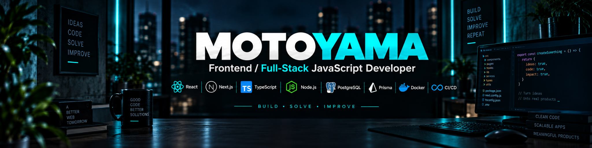

**Dayiawan MOTOYAMA**  
Frontend / Fullstack JavaScript Developer

I develop and maintain web applications, working across interfaces, APIs, databases and deployment. My main stack is React, Next.js, TypeScript and Node.js. I also work with Vue.js and PHP/Laravel.

My work includes application architecture, responsive interfaces, backend integrations, technical SEO, performance optimization and Linux production infrastructure. I'm open to Frontend / Fullstack JavaScript roles and commercial web development projects.

[Portfolio](https://motoyama.one) · [LinkedIn](https://www.linkedin.com/in/motoyama/) · [Email](mailto:info@motoyama.one)

## Selected Projects

### [HINDUISM.RU](https://hinduism.ru)

An educational platform and structured knowledge base on Hinduism, Indian philosophy and traditions. I built the Next.js application around a PostgreSQL content model, with search for readers and an admin interface for editing and publishing articles. The content workflow also supports preparing and importing material for publication.

### [MOTOYAMA.ONE](https://motoyama.one)

My portfolio and web development services site. I build and maintain the Next.js application, from responsive page layouts and server routes to backend integrations, technical SEO and performance work. I also maintain the production deployment.

- [**PROJECT PASSPORT**](https://passport.motoyama.one) — A site for a technical review service during website handover. I built eight localized versions with right-to-left layouts where needed, a Python static site generator, and browser checks for navigation.
- [**MOTOYAMA.ORG**](https://motoyama.org) — An interactive personal site. I built the graphics with JavaScript modules and Canvas, with responsive rendering, pointer and touch controls, and support for reduced motion.
- [**The Under MATRIX**](https://theundermatrix.com) — A directory of projects across the MOTOYAMA ecosystem. I used tabs, search and filtering to make the collection easier to navigate on desktop and mobile.

**More projects:** [motoyama.one/portfolio](https://motoyama.one/portfolio)

## Technology Stack

### Frontend

       

JavaScript, TypeScript, React, Next.js, Vue.js, HTML5, CSS3, SCSS

### Backend & APIs

   

Node.js, Express, PHP, Laravel, REST APIs, GraphQL

### Databases & State Management

  

PostgreSQL, MySQL, MongoDB, Redux Toolkit, RTK Query

### Tools & DevOps

     

Git, Docker, Linux, Nginx, Webpack, Vite, CI/CD

## Engineering Focus

- **Application Architecture:** Modular code, reusable components and clear interfaces between application layers.
- **APIs & Data:** REST and GraphQL integrations, authentication, application state, and data flow between the browser, services and databases.
- **Frontend Engineering:** Responsive layouts, accessibility, page performance and technical SEO.
- **Infrastructure & Deployment:** Linux deployments, server configuration, CI/CD and production maintenance.

## Professional Community

[Habr — Technical Articles](https://habr.com/ru/users/MOTOYAMA/articles/) · [VK — WebDevServ](https://vk.com/webdevserv) · [Telegram — WebDevServ](https://t.me/WebDevServ) · [YouTube — IT Server](https://youtube.com/@it-server)

## Contact

- **Portfolio:** [motoyama.one](https://motoyama.one)
- **LinkedIn:** [linkedin.com/in/motoyama](https://www.linkedin.com/in/motoyama/)
- **Email:** [info@motoyama.one](mailto:info@motoyama.one)
- **Personal Website:** [motoyama.org](https://motoyama.org)
